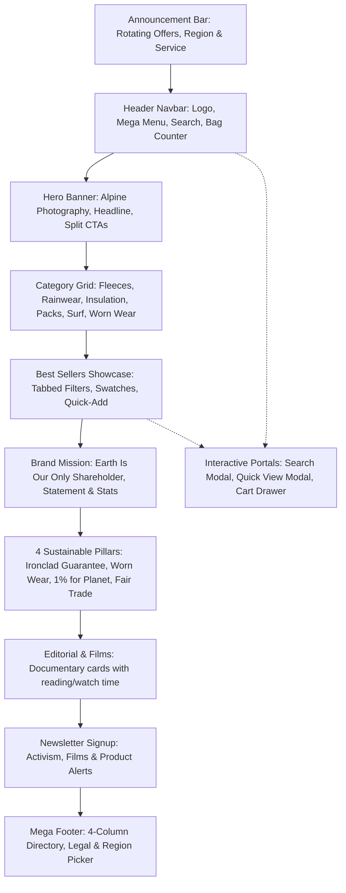

# Patagonia Homepage Topology & Assembly Blueprint

Target: `https://www.patagonia.com/`
Site Key: `patagonia-com`
Page Key: `root`

## Section Order & Specifications
1. **Announcement Bar (`announcement-bar.tsx`)**:
   - Background: Dark charcoal (`#1d1d1b`)
   - Text: White, small uppercase tracking (`text-xs tracking-wider font-medium`)
   - Left: Customer Service & Store Locator
   - Center: Auto-rotating announcements with slide transition
   - Right: Currency / US Region dropdown

2. **Main Header (`navbar.tsx` & `mega-menu.tsx`)**:
   - Height: 68px, sticky
   - Background: White with light blur and subtle bottom border
   - Brand Logo: Vector SVG with Fitz Roy mountain ridge styling
   - Navigation links: Shop (Men, Women, Kids, Packs), Activism, Stories, Worn Wear
   - Mega Menu flyouts with categorical item trees and editorial imagery
   - Utility icons: Search, Store locator, User profile, Bag with badge count

3. **Hero Section (`hero-banner.tsx`)**:
   - Full viewport height / 85vh
   - High-contrast typography with text drop-shadow
   - Headline: "Earth is now our only shareholder."
   - Subtitle on high-altitude alpine exploration
   - Twin primary CTAs: "Shop Men's" and "Shop Women's"
   - Environmental badge pill

4. **Category Grid (`category-grid.tsx`)**:
   - 6 high-impact visual cards with zoom-on-hover
   - Sub-badges highlighting technical specifications (e.g. "H2No® Waterproof", "100% Recycled")

5. **Product Showcase (`product-showcase.tsx`)**:
   - Filter tabs: All, Men's, Women's, Packs & Gear, Kids
   - Product cards with interactive color swatches, rating stars, price, and quick size buttons
   - Opens Quick View modal or adds item directly to bag drawer

6. **Brand Mission Spotlight (`brand-mission.tsx`)**:
   - Split layout with editorial quote from founder Yvon Chouinard
   - Three key metric counters: $140M+ environmental donations, 100% renewable power, 87% recycled lines

7. **Environmental Pillars (`environmental-features.tsx`)**:
   - 4 feature blocks: Ironclad Guarantee, Worn Wear®, 1% For The Planet®, Fair Trade Certified™

8. **Stories & Films (`stories-section.tsx`)**:
   - Editorial journalism cards featuring environmental defense and alpine expeditions
   - Interactive video player preview trigger

9. **Newsletter Section (`newsletter-section.tsx`)**:
   - Minimalist Patagonia field with email input and privacy statement
   - Live validation and confirmation state

10. **Global Footer (`footer.tsx`)**:
    - Four comprehensive navigational columns
    - Social links, B-Corp badge, 1% for Planet emblem
    - Copyright and legal links
